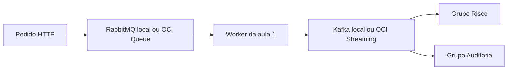

# Aprenda a executar e observar as aulas 1 e 2

Este projeto simula o recebimento de uma ordem e seu processamento por mensagens. Você vai iniciar os serviços, enviar uma ordem fictícia e acompanhar o que acontece. Não há conexão com uma bolsa ou operação financeira real.

**O código de todos os exemplos está na branch `feat/oci-queue-streaming`.**

**Comece pelo modo local com Podman.** Ele não usa créditos OCI. O código é Java 25, o build usa Maven e as camadas são controller, domain, infra e presenter.

- [Baixar o ZIP completo dos alunos](https://github.com/RafaelNevesdeOliveira/java-eventos/releases/download/aulas-1-e-2-v1.1.0/Laboratorios_EDA_Aulas_1_e_2_Java25.zip).
- [Ver a release e baixar o bundle ou os Word separadamente](https://github.com/RafaelNevesdeOliveira/java-eventos/releases/tag/aulas-1-e-2-v1.1.0).
- [Segundo README para criar a fila OCI desde o início](../README-OCI.md).

## 1 Entenda o que vai ficar rodando

Uma **API** recebe pedidos por HTTP. Uma **fila** guarda comandos até um worker recebê-los. Um **worker** é código que trabalha em segundo plano. Um **evento** registra algo que aconteceu. O **Kafka** guarda eventos para diferentes grupos lerem. O **PostgreSQL** guarda os dados da segunda aula.

Na primeira aula, um comando é atendido por um worker. Depois, os dois grupos recebem o evento:



Risco, Auditoria e os workers são componentes dentro da aplicação da aula 1. Eles não aparecem como três containers separados. O processo Java continua rodando para receber pedidos e mensagens.

| Serviço local | Para que serve | Onde observar |
| --- | --- | --- |
| `aula1` | API, workers e assinantes da primeira aula | Logs da aplicação; API na porta 8080 |
| `rabbitmq` | Fila de comandos | Painel em http://localhost:15673 |
| `kafka` | Eventos e grupos consumidores | Logs e comando de grupos apresentado abaixo |
| `aula2` | API, relay do Outbox e consumidor da segunda aula | Logs; consultas HTTP na porta 8082 |
| `postgres` | Ordens, Outbox, Inbox e posição | Consultas HTTP ou SQL apresentado abaixo |

Kafka não tem painel web instalado neste projeto. As portas 19092 e 5433 são conexões de serviço, não páginas para abrir no navegador.

## 2 Prepare o projeto uma única vez

Se já concluiu o preparador e viu **PRONTO**, vá para a etapa 3. Não faça outro clone.

Se ainda não preparou:

1. Baixe e extraia o ZIP completo em uma pasta nova.
2. Abra `Entrega_EDA_Alunos` e mantenha os arquivos juntos.
3. Execute somente o comando do seu sistema, nessa pasta.

Windows, no **PowerShell**:

```powershell
powershell.exe -NoProfile -ExecutionPolicy Bypass -File .\preparar-windows.ps1
```

Mac, no **Terminal**:

```sh
bash ./preparar-mac.sh
```

O preparador instala ferramentas ausentes, prepara Podman/Compose, faz o clone e inicia a aula 1 local. Se houver pedido de reinício no Windows, reinicie e repita. O primeiro build precisa de internet. O Maven compila o projeto dentro dos containers; esse caminho não exige Java ou Maven instalados no computador.

Se já havia uma cópia antiga, salve os exercícios fora dela e siga a mensagem Word do ZIP para fazer um novo clone, sem apagar backups ou volumes.

**Alternativa para quem já tem Git e Podman preparados e ainda não clonou:**

```sh
git clone -b feat/oci-queue-streaming https://github.com/RafaelNevesdeOliveira/java-eventos.git laboratorios-eda
cd laboratorios-eda
```

## 3 Abra dois terminais na pasta correta

Daqui em diante, os comandos são para **Terminal do Mac ou Git Bash do Windows**. O Git Bash vem com o Git; abra-o pelo menu Iniciar. Os exemplos usam a barra invertida `\` para continuar comandos na linha seguinte. Não cole esses blocos Bash no PowerShell.

Se usou o preparador, execute em cada terminal:

```sh
cd ~/JornadaB3/laboratorios-eda
```

Se escolheu outra pasta, entre nela. Confira:

```sh
pwd
git branch --show-current
ls
```

**Esperado:** branch `feat/oci-queue-streaming` e arquivos `pom.xml` e `compose.yaml`. As duas aulas estão nessa branch. Não troque para `aula-1` ou `aula-2` para seguir este README: essas são referências anteriores.

Se aparecer outra branch e você não tiver alterações próprias pendentes, confira `git status` e selecione a integrada:

```sh
git switch feat/oci-queue-streaming
```

Se o Git avisar que há alterações, salve seus exercícios antes de trocar. Não use reset para forçar a troca.

| Janela | O que fazer nela |
| --- | --- |
| Terminal 1 | Iniciar a aplicação e deixar os logs acompanhando |
| Terminal 2 | Enviar ordens, consultar resultados e conferir os serviços |

## 4 Coloque a aula 1 para rodar

No Terminal 1:

```sh
podman info
podman compose version
podman compose up -d --build aula1
podman compose logs -f aula1
```

`up` inicia os serviços; `--build` compila a aplicação com Maven; `-d` deixa os containers em segundo plano. O último comando acompanha os logs continuamente.

Espere aparecer **Started Application**. No Terminal 2:

```sh
podman compose ps
```

Devem estar ativos `aula1`, `rabbitmq` e `kafka`. Os brokers devem ficar saudáveis. Outros serviços já existentes também podem aparecer.

**Se já executa a API pelo Maven no computador**, encerre-a com Ctrl+C no terminal dela antes de subir o container na mesma porta. Escolha um modo de execução por aplicação.

## 5 Envie sua primeira ordem

No Terminal 2, copie o bloco inteiro:

```sh
curl -i -X POST http://localhost:8080/api/ordens \
  -H 'Content-Type: application/json' \
  -d '{"contaId":"iniciante-aula1-001","ativo":"PETR4","quantidade":10}'
```

`curl` é o cliente que envia a requisição. `POST` pede uma criação e `-d` contém os dados. Neste exemplo, a conta e a ordem são fictícias.

**Esperado:** HTTP **202** e JSON com `ordemId` e `status` igual a `COMANDO_ENFILEIRADO`. O identificador será diferente a cada pedido. O 202 confirma o comando recebido pelo broker; o processamento acontece depois.

No Terminal 1, procure:

- `WORKER=... comando=... evento publicado`: o comando foi processado.
- `GRUPO=RISCO`: o grupo Risco leu o evento.
- `GRUPO=AUDITORIA`: o grupo Auditoria também leu o evento.

Compare o ID do comando e o ID do evento registrado pelos grupos. Nesta aula eles permitem acompanhar a mesma ordem ao longo do fluxo. Os dois grupos lerem o mesmo evento é o resultado esperado.

A rota `/api/ordens` da aula 1 recebe **POST**. Abrir essa URL na barra do navegador envia GET e pode retornar 405; use o comando acima para enviar a ordem.

## 6 Veja a fila e os consumidores trabalhando

Abra http://localhost:15673 no navegador. Entre com **usuário `aluno` e senha `aluno-local`**. São credenciais públicas e exclusivamente locais deste laboratório.

Em **Queues and Streams**, abra `aula1.ordens.comandos`:

| Campo | O que significa |
| --- | --- |
| Ready | Comandos esperando um worker |
| Unacked | Comandos recebidos por workers, mas ainda não confirmados |
| Total | Ready mais Unacked |
| Consumers | Listeners conectados à fila |

É normal Ready e Unacked voltarem rapidamente a zero. A aplicação processa depressa; zero não significa que nada aconteceu. Veja também os gráficos de entrada/saída e os logs.

Para conferir a fila pelo terminal, sem consumir mensagens:

```sh
podman compose exec -T rabbitmq rabbitmqctl list_queues name messages_ready messages_unacknowledged consumers
```

Para conferir os grupos Kafka:

```sh
podman compose exec -T kafka /opt/kafka/bin/kafka-consumer-groups.sh \
  --bootstrap-server kafka:9092 --describe --group aula1-risco

podman compose exec -T kafka /opt/kafka/bin/kafka-consumer-groups.sh \
  --bootstrap-server kafka:9092 --describe --group aula1-auditoria
```

**LAG** é a diferença entre o final do histórico da partição e a posição confirmada pelo grupo. Depois do processamento ele deve convergir para zero. Os eventos continuam retidos no Kafka mesmo depois da leitura; eles não desaparecem como um comando confirmado na fila.

### Experimento para enxergar uma mensagem esperando

Este experimento é local e não usa OCI:

1. No Terminal 2, execute `podman compose stop aula1`. Isso para API e workers, mantendo RabbitMQ e Kafka ativos.
2. No painel RabbitMQ, abra a fila e expanda **Publish message**.
3. Em **Payload**, cole o JSON abaixo; se preencher `content_type`, use `text/plain`. Clique em **Publish message** uma vez.

```json
{"ordemId":"11111111-1111-4111-8111-111111111111","contaId":"iniciante-fila-001","ativo":"PETR4","quantidade":10}
```

4. Observe **Ready** aumentar. Como o worker está parado, esse comando espera na fila. Não tente enviar pelo HTTP enquanto a API estiver parada.
5. No Terminal 2, execute `podman compose start aula1`.
6. No Terminal 1, se o acompanhamento tiver terminado, repita `podman compose logs -f aula1`. Espere a inicialização e veja o comando ser processado e os dois grupos receberem o evento. Ready deve diminuir.

Se repetir o experimento, use outra conta e outro UUID em `ordemId`. A primeira aula não implementa deduplicação do efeito; a segunda mostra esse assunto.

## 7 Passe para a aula 2

No Terminal 1, pressione Ctrl+C para sair dos logs. **Isso não para os containers.** Depois execute:

```sh
podman compose stop aula1
podman compose up -d --build aula2
podman compose logs -f aula2
```

Não precisa trocar de branch. Espere **Started Application**. A API da segunda aula fica em **8082**.

No Terminal 2:

```sh
curl -s http://localhost:8082/api/lab/status
```

Você verá `relayPausado`, `ordens`, `outbox`, `inbox` e `pendentes`. Os contadores podem ser maiores que zero se já houver exercícios ou testes anteriores.

O fluxo desta aula é: HTTP → ordem e Outbox na mesma transação → relay → Kafka → Inbox e posição na mesma transação. O relay é um processo agendado dentro da aplicação, não outro container.

## 8 Crie uma ordem e observe o banco

Use uma conta nova para cada repetição do experimento. Troque `001` por `002`, `003` etc. se já usou esse exemplo:

```sh
curl -i -X POST http://localhost:8082/api/ordens \
  -H 'Content-Type: application/json' \
  -d '{"contaId":"iniciante-aula2-001","ativo":"PETR4","quantidade":10}'
```

**Esperado:** HTTP **201**, com um envelope de evento. Guarde o campo **`id` do nível principal**: ele identifica o evento. `data.ordemId` identifica a ordem e tem outro uso.

Espere alguns segundos. Estas URLs podem ser abertas no navegador ou consultadas com curl:

| URL | O que procurar |
| --- | --- |
| http://localhost:8082/api/ordens | A ordem gravada para sua conta |
| http://localhost:8082/api/outbox | O evento; `publicada_em` preenchida após a confirmação Kafka |
| http://localhost:8082/api/posicoes | Sua conta e o ativo, com quantidade 10 na primeira ordem |
| http://localhost:8082/api/lab/status | `pendentes` voltando a zero |

Nos logs, procure `POSICAO_ATUALIZADA`. A posição pode aparecer depois da resposta HTTP; isso é a consistência eventual que a aula demonstra.

Para ver as tabelas pelo terminal:

```sh
podman compose exec -T postgres psql -U aluno -d eda \
  -c "SELECT id, conta_id, ativo, quantidade FROM ordens ORDER BY criada_em DESC LIMIT 5;"

podman compose exec -T postgres psql -U aluno -d eda \
  -c "SELECT id, publicada_em FROM outbox ORDER BY criada_em DESC LIMIT 5;"

podman compose exec -T postgres psql -U aluno -d eda \
  -c "SELECT consumer_name, event_id FROM inbox ORDER BY processado_em DESC LIMIT 5;"

podman compose exec -T postgres psql -U aluno -d eda \
  -c "SELECT conta_id, ativo, quantidade FROM posicao ORDER BY conta_id;"
```

`outbox` é a lista de eventos a publicar; `inbox` registra quais eventos aquele consumidor já aplicou; `posicao` é o resultado consultado pelo usuário. Essas consultas são do modo local, no schema padrão.

## 9 Simule um processo parado sem perder a ordem

Pause o relay, mantendo a API e o banco funcionando:

```sh
curl -s -X POST http://localhost:8082/api/lab/relay/pausar
```

Envie uma ordem com outra conta, por exemplo `iniciante-pausa-001`:

```sh
curl -i -X POST http://localhost:8082/api/ordens \
  -H 'Content-Type: application/json' \
  -d '{"contaId":"iniciante-pausa-001","ativo":"PETR4","quantidade":10}'
```

Observe `/api/lab/status`, `/api/outbox` e `/api/posicoes`: o relay deve estar pausado, o evento deve estar pendente com `publicada_em: null` e a posição dessa conta ainda não deve existir. A ordem já foi gravada.

Agora retome:

```sh
curl -s -X POST http://localhost:8082/api/lab/relay/retomar
```

Espere alguns segundos e consulte novamente. A posição deve aparecer com quantidade 10, o evento deve ter data de publicação e os pendentes devem diminuir. Retome o relay ao terminar o experimento.

## 10 Simule uma falha de transação

Primeiro consulte `/api/lab/status`. Sem enviar outras ordens ao mesmo tempo, execute:

```sh
curl -i -X POST 'http://localhost:8082/api/ordens?falhar=true' \
  -H 'Content-Type: application/json' \
  -d '{"contaId":"iniciante-falha-001","ativo":"PETR4","quantidade":10}'
```

**Esperado:** HTTP **503**, com uma falha simulada. Consulte o status novamente: os totais de `ordens` e `outbox` não devem aumentar por essa tentativa. A transação foi revertida; não ficou uma ordem gravada sem seu evento.

## 11 Reenvie o mesmo evento sem aumentar a posição

Escolha o `id` de um evento já publicado para uma conta que recebeu somente uma ordem de quantidade 10. Copie o `id` do evento da resposta ou de `/api/outbox`, não `data.ordemId`.

No comando abaixo, substitua o texto entre aspas pelo ID real:

```sh
EVENTO='cole-aqui-o-id-do-evento'
curl -i -X POST "http://localhost:8082/api/lab/outbox/$EVENTO/reenviar"
```

Espere a publicação e repita a última linha mais duas vezes. Consulte `/api/posicoes`. **A quantidade daquela conta deve continuar em 10**, porque você reenviou o mesmo evento. Nos logs, procure `DUPLICATA_IGNORADA`.

Enviar um novo POST de criação é diferente: ele cria outra ordem e outro evento, portanto pode aumentar a posição. A Inbox deduplica pelo ID do evento, não pelo conteúdo de duas ordens diferentes.

## 12 Execute a verificação automática

Com a API correspondente aberta, no Mac use:

```sh
python3 scripts/smoke.py --aula 1
python3 scripts/smoke.py --aula 2
```

No Windows, se o comando disponível for `python`, use esse nome no lugar de `python3`. Rode somente a aula que estiver ativa. O teste da aula 2 cria dados próprios e exercita validação, rollback, pausa/retomada e três reenvios. Evite outras escritas durante esse teste.

## 13 Prefere executar Java pelo Maven no computador

Esse é um caminho alternativo para usar a IDE e colocar breakpoints. Exige **JDK 25 e Maven 3.9** instalados no host. Confira `java -version` e `mvn -version`.

Pare o container da aplicação que vai executar, para liberar a porta:

```sh
podman compose stop aula1 aula2
```

No Mac, escolha **um** dos comandos e deixe esse terminal aberto:

```sh
./scripts/iniciar.sh 1 local
# Ou, para a segunda aula:
./scripts/iniciar.sh 2 local
```

O script prepara os brokers/banco e executa `mvn spring-boot:run`. Para parar essa API, use Ctrl+C no terminal dela.

No Windows, com Git Bash, instale o módulo compartilhado e inicie a aula escolhida:

```sh
mvn -B install -DskipTests
podman compose up -d --wait rabbitmq kafka
mvn -B -pl aula1 spring-boot:run -Dspring-boot.run.profiles=local
```

Para a aula 2, encerre o Maven da aula 1 e use:

```sh
podman compose up -d --wait postgres kafka
mvn -B -pl aula2 spring-boot:run -Dspring-boot.run.profiles=local
```

`mvn -B verify` executa os testes Java/ArchUnit. Na versão integrada de referência são 33 testes sem falhas; eles não substituem a observação dos serviços reais.

## 14 Experimente OCI somente quando quiser usar a nuvem

Siga primeiro o [README de criação da fila OCI](../README-OCI.md). Criar a fila é uma etapa; conectar toda a aula também exige Streaming e autenticação própria.

Com a configuração privada pronta, no Mac:

```sh
./scripts/iniciar.sh 1 oci
# Em outro terminal, se for usar a segunda aula:
./scripts/iniciar.sh 2 oci
```

As APIs ficam em **8180/8182**. Para repetir os exemplos HTTP, troque somente a porta correspondente. O painel RabbitMQ mostra a fila local, não a fila OCI. Observe o Queue no Console Oracle e os logs `OCI_QUEUE_CONFIRMADO`, `GRUPO=RISCO` e `GRUPO=AUDITORIA` no terminal Maven.

A aula 2 OCI mantém PostgreSQL no Podman, usando o schema separado `oci_aulas`. Não compare suas tabelas com o schema local `public`. [Configuração técnica e comandos PowerShell OCI](https://github.com/RafaelNevesdeOliveira/java-eventos/blob/feat/oci-queue-streaming/docs/OCI.md).

Para não deixar consultas à fila em segundo plano, **encerre o Maven OCI com Ctrl+C quando terminar**. Abrir o Console não inicia o worker Java. Manter a aplicação OCI aberta mantém seu polling, mesmo sem ordens novas. Queue e Streaming têm formas de cobrança próprias; [consulte os preços Oracle](https://www.oracle.com/cloud/price-list/).

## 15 Encerre sem perder seus exercícios

Se iniciou Java pelo Maven, use Ctrl+C no terminal de cada aplicação. Depois:

```sh
podman compose --profile contratos down
```

Esse comando encerra os containers do projeto e preserva os volumes. Não acrescente `-v`, não execute `podman machine reset` e não apague a pasta dos exercícios para resolver uma falha.

## Se algo não funcionar

| Sintoma | O que conferir |
| --- | --- |
| `podman` não encontrado | Conclua o preparador e reabra o terminal |
| Falha de conexão com Podman | Abra Podman Desktop; confira `podman machine list`; se a VM existente estiver parada, inicie-a sem recriá-la |
| Porta já ocupada | Pode haver a mesma API aberta no Maven e no container; encerre a execução anterior |
| HTTP 405 na aula 1 | Use POST com curl, não a barra do navegador |
| HTTP 400 | Confira conta, ativo em maiúsculas e quantidade maior que zero |
| HTTP 503 com `falhar=true` | É a falha prevista no experimento de rollback |
| Fila local vazia após o envio | Confira logs: o worker pode ter processado imediatamente |
| Posição ainda não apareceu | Aguarde alguns segundos, confira o relay, os logs e os pendentes |
| `DUPLICATA_IGNORADA` | O mesmo evento já foi aplicado; esse é o comportamento esperado no reenvio |
| Erro OCI de autenticação | Confira sessão CLI, Auth Token, região e domínio/usuário SASL pelo segundo README |

## Onde ler as classes

- [Mapa das quatro camadas](https://github.com/RafaelNevesdeOliveira/java-eventos/blob/feat/oci-queue-streaming/docs/ARQUITETURA.md).
- [Cada classe e quem chama quem](https://github.com/RafaelNevesdeOliveira/java-eventos/blob/feat/oci-queue-streaming/docs/CLASSES-E-FLUXOS.md).
- [Guia de exercícios da aula 1](https://github.com/RafaelNevesdeOliveira/java-eventos/blob/feat/oci-queue-streaming/docs/AULA-1.md).
- [Guia de exercícios da aula 2](https://github.com/RafaelNevesdeOliveira/java-eventos/blob/feat/oci-queue-streaming/docs/AULA-2.md).
- [Validação local e OCI](https://github.com/RafaelNevesdeOliveira/java-eventos/blob/feat/oci-queue-streaming/docs/VALIDACAO-OCI.md).
